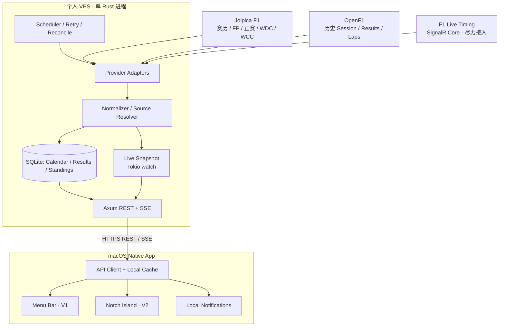

# F1 Companion — 最终技术方案

> **版本**：1.0 · **日期**：2026-10-08  
> **定位**：个人自托管、非商业、免费数据源、原生 macOS Menu Bar + Notch Live Timing  
> **决策状态**：架构冻结，可以开始实现；Live Feed 接入需以真实 Session 验证

## 1. 项目目标与边界

### 1.1 产品目标

提供一款长期运行、低资源占用的个人 F1 Companion：

1. **V1 — Menu Bar Data（基础设施与原生 App）**
   - 全赛季赛历、比赛周各 Session 的本地时间和倒计时。
   - FP1 / FP2 / FP3、Sprint Qualifying、Sprint、Qualifying、Race 的结果。
   - WDC / WCC 积分榜、车手与车队信息。
   - Session 开始前的本地提醒；赛后自动同步与展示成绩。
   - 断网时仍可查看上次缓存的赛程、积分与结果，并显示更新状态。
2. **V2 — macOS Notch Live（Dynamic Island 风格）**
   - Session 期间自动展示紧凑态 Notch：Session、当前圈数、关注车手名次和间隔。
   - 展开后展示 Timing Leaderboard、最佳圈、轮胎/进站、赛会状态与 Race Control 信息（以实际数据源字段为准）。
   - 目标为**分钟级可感知更新**；不追求高频物理遥测、逐帧车辆位置动画。
   - Live Feed 不可用时，自动降级至 Session 进行中状态/倒计时；不伪造实时数据。

### 1.2 非目标

不开发账户系统、多租户、商业 API、订阅与计费、社交系统、手机端、独立前端网站；不引入 Redis、Kafka、Kubernetes 或第二个后端运行时。**服务端不使用 Node.js、Python 或 .NET。**

项目只服务个人，但上游数据的访问限制仍需遵守；不要依赖绕过认证、付费墙或访问控制。

### 1.3 验收优先级

| 优先级 | 结果 |
|---|---|
| P0 | 赛历和历年成绩稳定获取，并有本地缓存 |
| P0 | FP1 等 Session 结束后自动尝试获取结果，准确显示数据时间戳 |
| P0 | Rust 单进程常驻运行，Mac App 可正常读取数据 |
| P1 | WDC/WCC、提醒、结果修正检测、断网恢复 |
| P1 | Live Feed 可用时，Mac Notch 正常展示 Timing |
| P2 | 更丰富的圈速、轮胎与 Race Control UI |

---

## 2. 技术栈（最终决定）

| 层 | 技术 | 目的 |
|---|---|---|
| VPS 语言 | **Rust 2024 Edition** | 原生二进制、低常驻开销、无 GC |
| 异步运行时 | **Tokio** | 采集、后台同步、定时任务、SSE |
| HTTP API | **Axum** | REST、SSE、状态查询 |
| HTTP Client | **Reqwest** | 上游 REST 获取、复用连接 |
| F1 Live | **Rust SignalR Core Client** | 首选验证 `signalr-client`；不兼容则基于 `tokio-tungstenite` 实现必要协议适配 |
| JSON | **Serde / serde_json** | 数据解析、统一模型 |
| DB | **SQLite + rusqlite** | 本地结构化持久化；通过单独阻塞任务读写 |
| Live State | **Tokio `watch` + 内存 Snapshot** | 最新数据共享，不积压过期状态 |
| 调度 | **Tokio tasks + interval / sleep_until** | 无独立调度基础设施 |
| 日志 | **tracing / tracing-subscriber** | 状态与故障诊断 |
| VPS 部署 | **Release binary + systemd** | 不依赖 Docker daemon；容器化作为可选项 |
| macOS 语言 | **Swift 6 + SwiftUI + 必要的 AppKit** | 原生 UI 与进程生命周期 |
| Menu Bar | **MenuBarExtra `.window`** | 赛历、成绩、积分展示；必要时替换为 `NSStatusItem + NSPopover` |
| Notch | **OpenNook** | 优先集成 `NookKit` / `NookSurface`，避免双 `App` 入口 |
| Mac 数据连接 | **URLSession REST + SSE** | 静态请求与实时推送 |
| Mac 缓存 | **Codable + 本地文件** | 离线可用与断线回退 |
| Mac 通知 | **UserNotifications** | 本地 Session 提醒 |
| 密钥 | **macOS Keychain + VPS 环境变量** | 个人 API Token |

**性能原则**：后端只运行一个 Rust 服务；Live 数据不经 SQLite 热路径；HTTP 连接复用；只保存所需 Timing 数据；不要频繁重建大 JSON；定量指标以真实测量为准，**不预先承诺固定内存占用**。

---

## 3. 系统架构



**职责分离**：

- **VPS**：所有上游采集、数据规范化、持久化、重试与统一 API；客户端不直接请求第三方数据源。地图渲染是明确例外：WKWebView 直连 Mapbox 官方 GL JS、底图、地形、字体及 3D 模型，只接收公开只读 Mapbox token；F1、天气、雷达与音频仍由 Rust adapter 获取。
- **Mac**：展示、偏好设置、缓存、通知与 Notch 状态；不计算官方积分，不承担核心数据采集。
- **单进程**：采集器、后台任务和 HTTP API 在同一 Rust 进程内；多任务并发，不是微服务。

---

## 4. 数据源策略

| 数据 | 主源 | 备用 / 校验 | 备注 |
|---|---|---|---|
| 赛历及 Session 开始时间 | Jolpica | OpenF1 | 全部转 UTC 存储，Mac 本地时区展示 |
| FP1 / FP2 / FP3 | **Jolpica Alpha 与 OpenF1 竞速获取** | 二者相互补充 | 谁先有完整成绩就采用谁，不等另一方 |
| Qualifying / Sprint / Race 结果 | Jolpica | OpenF1 | 允许处罚后更正 |
| WDC / WCC | Jolpica | 独立校验 | 不直接套用其他项目的旧积分规则 |
| Live Timing / Race Control | F1 SignalR Core | 暂无可靠免费备用 | 实际连通、字段和数据质量待验证 |
| 2023 年以来历史圈速 / 遥测 | OpenF1 | — | 如需展示再分批采集，避免全量高频存储 |

### 4.1 关键数据事实

- **OpenF1**：2023 年以来的历史数据免费、无需认证；实时数据属于付费能力。`session_result` 通常在官方成绩发布后数分钟入库，但“入库时间”**不等于免费匿名端点立即可用**。
- **Jolpica Alpha**：2026 年已提供可测试的练习赛、排位赛、冲刺及正赛 Results API；Alpha 接口可能调整字段或路径，因此必须做 Adapter 隔离。
- **F1 SignalR**：`FastF1` 和开源 `f1-live-api` 提供了协议、Topic 订阅及增量合并的参考；不能据此认定无认证 Live 在任何比赛都能稳定返回完整数据。

### 4.2 FP1 结束后的同步目标

用户目标是“FP1 结束后尽快拿到 FP1 数据”，因此采用**两个来源并行轮询 + 先到先用 + 后续校验**：

1. 结束时间通过赛历与 Live `SessionStatus` 推断；若有延迟、红旗、延期，以最新 Session 状态为准。
2. Session 结束后立即查询 Jolpica Alpha 可用结果，并开始指数退避下的快速轮询（例如每 2–5 分钟；遵守 429 和 Retry-After）。
3. 同时检查 OpenF1 的 `session_result`；受实时访问窗口约束时暂不频繁重试。
4. 任意来源首次返回**有效完整结果**时，立即写入 SQLite 并通知 Mac 刷新；保留 `source`、`fetchedAt`、`publishedAt`（如上游提供）和 `revision`。
5. 数小时内继续低频核对；发生罚时或官方成绩修正时更新版本。

**SLO（目标，不是保证）**：首次可公开获取后 **≤5 分钟进入本地服务**；最终端到端耗时受上游发布与匿名访问窗口影响。验收时测量结束后 5 / 15 / 30 / 45 / 60 分钟的实际可用程度。

### 4.3 数据质量

- 保存每条结果的 `source`, `sourceUpdatedAt?`, `fetchedAt`, `revision`, `quality`。
- `quality` 推荐：`unavailable | partial | provisional | confirmed`。`confirmed` 仅在明确获得可信确认依据时赋值，**不能因为 API 有数据就叫“官方最终结果”**。
- 优先稳定主键：`season + round + sessionType`；保存来源自身的 `meeting_key` / `session_key` / `round_id` 映射；处理冲刺周特殊 Session。
- `DateTime` 传输始终使用 RFC 3339 UTC；精度和零值明确约定，间隔字段可以是时间、圈差或空值，不能盲目转 `f64`。

---

## 5. Rust 服务端设计

### 5.1 内部模块

```text
server/
├── Cargo.toml
├── Cargo.lock
├── src/
│   ├── main.rs
│   ├── config.rs
│   ├── app_state.rs
│   ├── providers/
│   │   ├── mod.rs
│   │   ├── jolpica.rs
│   │   ├── openf1.rs
│   │   └── f1_live/
│   │       ├── client.rs       # SignalR 连接、握手、订阅
│   │       ├── protocol.rs     # 消息解析 / frame
│   │       ├── patches.rs      # 差量增量合并
│   │       └── models.rs
│   ├── domain/
│   │   ├── calendar.rs
│   │   ├── session.rs
│   │   ├── results.rs
│   │   ├── standings.rs
│   │   └── live.rs
│   ├── services/
│   │   ├── sync.rs
│   │   ├── reconcile.rs
│   │   └── live_state.rs
│   ├── storage/
│   │   ├── sqlite.rs
│   │   └── migrations/
│   ├── scheduler.rs
│   └── api/
│       ├── mod.rs
│       ├── routes.rs
│       ├── dto.rs
│       └── sse.rs
├── tests/
└── deploy/
    ├── f1-companion.service
    └── config.example.toml
```

### 5.2 Live 状态流（核心）

```text
F1 SignalR Message
    ↓ parse
Topic Patch
    ↓ serial reducer（按接收顺序）
Normalized Live Snapshot
    ↓ publish (tokio::sync::watch)
Axum SSE stream
    ↓
macOS LiveStore
    ↓
Menu Bar + Notch
```

- **SignalR**：先验证 `signalr-client` 对 F1 的握手、认证状态、订阅、事件回调是否兼容；不兼容就使用 `tokio-tungstenite` 实现必要协议层，**仍坚持纯 Rust**。
- **Topic**：优先 `SessionInfo`、`SessionStatus`、`DriverList`、`TimingData`、`LapCount`、`TrackStatus`、`RaceControlMessages`；轮胎等字段再按 `TimingAppData`/实际结构补充。默认不订阅体积大的车辆位置/物理遥测。
- **Reducer**：按 Topic 维护状态并正确 deep-merge patch；不得把 patch 当整份状态覆盖。重连应重新获取初始状态，避免旧数据与新 Session 混合。
- **Channel**：`watch` 用于最新状态，每个 SSE 订阅者只关心最新快照；提供心跳、`stateVersion` 和 `lastUpdatedAt`；可能存在中间事件丢失，因此 UI 不用它做逐条不可丢审计。
- **SSE**：建立连接先发完整 `snapshot`，后发 `snapshot`（可节流合并，例如每 10–30 秒）及 `status`；断线重连重新拉取完整快照。暂不做基于事件历史的复杂续传。
- **状态过期**：超过阈值未收到上游数据，则展示 `stale` / `disconnected`，不得继续标榜实时。

### 5.3 调度

| 时段 | 策略 |
|---|---|
| 普通工作日 | 赛历 / 积分每 6 小时同步一次 |
| 距 Session 24 小时内 | 赛程每 30 分钟核对 |
| Session 前 5 分钟 | 尝试建立 Live 连接；若需要认证则不尝试绕过 |
| Session 进行中 | SignalR 长连接；发送聚合后的 SSE Snapshot |
| Session 结束后 | Results 每 2–5 分钟探测，遵循 API 限流和退避 |
| 首次结果可用后 | 立即持久化；随后每 30–60 分钟核对修订，逐渐降频 |
| 服务重启 | 启动先加载 SQLite，启动定时同步，再建立可用 Live 流 |

只使用 Tokio 的定时任务即可；不部署 cron 集群或消息代理。

### 5.4 SQLite

主要逻辑表：

- `meetings`、`sessions`：赛历和 Session 时间、状态、来源映射。
- `session_results`：车手/位置/时间/分类、结果质量、版本。
- `driver_standings`、`constructor_standings`：积分快照。
- `sync_state`：每个 Provider/Endpoint 的成功时间、ETag、重试时间及错误摘要。
- `preferences_server`（可选）：只有真正需要跨设备同步时才加入。

数据库开启 WAL，关键字段建索引。由于单人、低写入量，**`rusqlite` + `spawn_blocking` / 专用数据库任务**足够；不需要因为异步 HTTP 就强行将 SQLite 操作塞进 Tokio 异步线程。

---

## 6. API 契约

所有 API 基于 `/api/v1`；私有部署可通过任意主机/IP 的 http(s) + Bearer Token 访问（或只绑定 Tailscale 私网），公网使用建议 HTTPS。

```http
GET /api/v1/health
GET /api/v1/calendar?season=2026
GET /api/v1/meetings/next
GET /api/v1/sessions/{sessionId}/results
GET /api/v1/standings/drivers?season=2026
GET /api/v1/standings/constructors?season=2026
GET /api/v1/live/snapshot
GET /api/v1/live/stream
```

统一响应包裹（示例，不代表真实赛事）：

```json
{
  "data": {
    "sessionId": "2026-r01-fp1",
    "sessionType": "FP1",
    "status": "finished",
    "quality": "provisional",
    "results": []
  },
  "meta": {
    "source": "jolpica-alpha",
    "fetchedAt": "2026-03-06T04:15:00Z",
    "revision": 1,
    "stale": false
  }
}
```

SSE 契约：

```text
event: snapshot
data: {"stateVersion":17,"sessionId":"...","updatedAt":"...","sourceStatus":"live","drivers":[]}

: keep-alive

event: status
data: {"sourceStatus":"disconnected","reason":"upstream_timeout"}
```

建议响应体含 `schemaVersion`；以 UTC 标记全部时间；展示侧不得假定 `position`、gap 和 tyre 始终存在。

---

## 7. macOS App 设计

### 7.1 结构

```text
macos/
├── F1Companion.xcodeproj
├── App/
│   ├── F1CompanionApp.swift
│   └── AppLifecycle.swift
├── Core/
│   ├── APIClient/
│   ├── Models/
│   ├── LiveStore/
│   ├── Cache/
│   └── Notifications/
├── Features/
│   ├── MenuBar/
│   ├── Calendar/
│   ├── SessionResults/
│   ├── Standings/
│   ├── LiveIsland/
│   └── Preferences/
└── Resources/
```

单一 `App` 生命周期：

- Menu Bar 使用 `MenuBarExtra(.window)`，不需要 Dock 图标时设置 accessory/menu bar 应用模式。
- Notch 使用 OpenNook 的公共组件/API；**先做一个 SwiftUI App + Nook 集成 Spike**，确认 `MenuBarExtra` 与 OpenNook 的窗口管理不会冲突，再决定是否需要降至 `NookSurface` / 手动 `NSPanel`。
- `LiveStore` 在单进程内共享，Menu Bar 与 Notch 只读统一状态；SSE 只有一个连接。
- 偏好设置：服务端地址、Token、关注车手（默认为用户设置，而不是写死）、Notch 自动显示开关、提醒时间、刷新策略。

### 7.2 UI 状态

| 状态 | Menu Bar | Notch |
|---|---|---|
| 非比赛周 | 下次比赛 / Session 倒计时 | 默认隐藏 |
| 比赛周、尚未开始 | Session 时间和近期历史结果 | 默认隐藏或手动打开 |
| Live 可用 | 实时 Session 和简要状态 | 自动紧凑态，悬停/点击展开 |
| Live 不可用 | Session 进行中 + 数据状态 | 展示“Live unavailable”或隐藏 |
| Session 结束 | 成绩正在同步 / 初步结果 | 短暂停留后收起 |
| VPS 不可达 | 展示缓存和最后更新时间 | 标记离线，不显示旧值为实时 |

macOS 没有对第三方开放与 iPhone 完全等同的系统级 Dynamic Island API；这里的「Dynamic Island」是**自绘的 Notch 窗口体验**，不是 iOS Live Activities。

### 7.3 时间与缓存

- 后端 UTC 存储、客户端使用 `Date` + `Calendar/TimeZone` 转换。
- 倒计时按照目标 `Date` 与当前时间的差计算，唤醒后重新计算，不通过递减秒数维护。
- `URLSession` 长连接断开后退避重试；重新连接先拉 `snapshot`。
- 本地缓存存完整赛历、最近积分榜和近期 Session 结果；更新采用原子写入，过期标注 `lastUpdatedAt`。
- 本地提醒以 Session 更新时间重新安排，赛程变化要取消并重建旧提醒。

---

## 8. 部署与运维

### 8.1 生产形态

**推荐：systemd + Release Binary + SQLite 文件**。不使用独立代理进程也可部署；实际接公网时可复用 VPS 已有 HTTPS 入口反代。

```text
/opt/f1-companion/f1-companion
/etc/f1-companion/config.toml
/var/lib/f1-companion/f1.sqlite
/var/log/...  # journald
```

基础配置示例：

```toml
[server]
bind = "127.0.0.1:38701"

[database]
path = "/var/lib/f1-companion/f1.sqlite"

[providers]
jolpica_enabled = true
openf1_enabled = true
f1_live_enabled = true

[live]
snapshot_interval_seconds = 15
stale_after_seconds = 60

[security]
# 从环境变量 F1_COMPANION_TOKEN 读取，不写在仓库
require_token = true
```

- 构建：`cargo build --release`；服务以非 root 用户运行，`Restart=on-failure`。
- 公网访问：建议 HTTPS + Token 防止接口被任意访问；客户端允许任意主机/IP 与 http(s)，内网可直接用 LAN/Tailscale 地址。
- 日志保留错误、连接状态、同步耗时和最新成功时间；避免记录完整 Token、敏感请求头与长篇原始 Feed。
- 备份 SQLite（使用 SQLite 在线备份/一致性策略），无需备份 Live 内存状态。
- 不设置硬性内存指标为事实；部署后用 `/usr/bin/time -v`、`systemd-cgtop`、`journalctl` 实测 CPU/RSS/错误率。

### 8.2 故障与降级矩阵

| 故障 | 行为 |
|---|---|
| Jolpica 不可用 | 使用 SQLite 缓存；尝试适用的 OpenF1 字段 |
| OpenF1 不可用 | Jolpica 继续负责赛历与成绩 |
| F1 Live 需授权/拒绝连接 | 仅关闭 V2 实时能力，V1 完整可用 |
| SSE 中断 | App 重连，恢复后先取完整 Snapshot |
| VPS 重启 | SQLite 恢复静态数据；Live 状态重新初始化 |
| 同源结果互相矛盾 | 显示来源/版本，按预定义来源优先级处理；记录冲突供检查 |

---

## 9. 实施计划（按依赖顺序，不按日期承诺）

### Phase 0 — 数据与协议 Spike（必须先做）

- [ ] 用 Reqwest 查询 Jolpica 常规 API 和 Alpha Results、OpenF1 Session Results。
- [ ] 映射某一已完成 FP1 的两源结果；验证字段类型、完整度及分页。
- [ ] Rust 接入 F1 SignalR 的 negotiate / websocket / subscribe；验证是否需要认证、是否能获得 `TimingData` 等 Topic。
- [ ] 用历史 Feed 或录制样本做 patch/reducer 单元测试；在真实比赛 Session 复验 Live。
- [ ] 如果 Rust SignalR crate 不兼容，纯 Rust 编写必要协议层，不引入 Node.js Sidecar。

**完成条件**：历史数据可查；Live 能力得出明确 `available / partial / blocked` 结论，不以猜测判定成功。

### Phase 1 — Rust Infra

- [ ] 完成统一模型与来源 ID 映射。
- [ ] 完成 SQLite migrations、Cache、Source Resolver、Scheduler。
- [ ] 完成 REST、Token 校验、健康检查和基础日志。
- [ ] 完成 Live Snapshot Reducer 和 SSE（即使上游 Live 暂不可用，也能用模拟 Feed 测通）。
- [ ] 发布 systemd 服务并验证重启、恢复、断网、限流和结果版本更新。

### Phase 2 — macOS V1

- [ ] Menu Bar、Popup、赛历与 Session 时间。
- [ ] FP / Quali / Sprint / Race Results、WDC/WCC。
- [ ] 本地缓存、离线、时区与提醒。
- [ ] 完成至少一次练习赛赛后自动获取的端到端记录。

### Phase 3 — macOS V2

- [ ] OpenNook 与 MenuBarExtra 生命周期集成 Spike。
- [ ] LiveStore + SSE + stale/reconnect 状态。
- [ ] Notch 紧凑态、展开态、关注车手与 Race Control。
- [ ] Live Session 自动激活/收起，以及 Live 不可用时降级。
- [ ] 真实比赛验证分钟级数据时效。

### Phase 4 — 验收

- [ ] 赛历覆盖完整赛季，所有 Session 时间在 Mac 本地时区正确显示。
- [ ] 练习赛结束后 5/15/30/45/60 分钟记录每个 Provider 数据可用性。
- [ ] Result 首次可读、同源/跨源修正时，Mac 自动展示更新。
- [ ] 强制断开 SSE、终止 VPS、断网、睡眠/唤醒均不显示“假实时”。
- [ ] 在真实 VPS 上记录闲置与赛事期间 RSS/CPU；先测量后优化。

---

## 10. 技术决定与暂未证实的前提

**已经确定**：Rust/Tokio/Axum/Reqwest/SQLite，原生 SwiftUI，Menu Bar + OpenNook，REST + SSE，免费历史数据作为基本盘，个人 VPS 单实例。

**需要先验证**：

1. **Live 访问**：F1 SignalR 匿名/已有合法访问方式能否在 2026 的实际 Session 提供所需 Timing 字段；Rust 库是否完全兼容。
2. **练习赛数据时效**：Jolpica Alpha 与 OpenF1 到底谁先开放完整 FP 成绩。不能将“官方公布后几分钟入库”理解为匿名免费 API 立即可读。
3. **OpenNook 集成**：`NookApp.main` 默认入口与已有 SwiftUI `App`/`MenuBarExtra` 的共存方式；优先复用组件，不盲目复用第二个 App 入口。

**决策规则**：无论 Live Spike 结果如何，都不阻止完成 V1；Live 可用则开启 V2，不可用则以 Session 状态和赛后成绩保留完整使用体验。

---

## 11. 参考资料（2026-10-08 核对）

1. OpenF1 API 文档：https://openf1.org/docs/
2. Jolpica API Swagger / Alpha：https://api.jolpi.ca/docs/
3. Jolpica Alpha Results 发布说明：https://github.com/jolpica/jolpica-f1/discussions/319
4. Jolpica 项目：https://github.com/jolpica/jolpica-f1
5. FastF1 SignalR Client 实现：https://github.com/theOehrly/Fast-F1/blob/main/fastf1/livetiming/client.py
6. f1-live-api 实现参考（不作为运行依赖）：https://github.com/harsh779/f1-live-api
7. Rust `signalr-client` 文档：https://docs.rs/signalr-client/latest/signalr_client/
8. OpenNook：https://github.com/twinkling-reality/opennook
9. OpenNook 安装/兼容性：https://opennook.dev/start/install/
10. Axum 文档：https://docs.rs/axum/
11. Tokio 文档：https://tokio.rs/

---

## 最终一句话

> **一个 Rust 单进程 VPS Infra，使用 Jolpica + OpenF1 承担免费稳定的赛历和历史数据，尽力接入 F1 SignalR 作为实时数据源；一个 SwiftUI macOS App，以 Menu Bar 常驻、OpenNook 展示赛中 Live。所有数据通过 REST + SSE 统一提供，V2 故障不影响 V1。**
