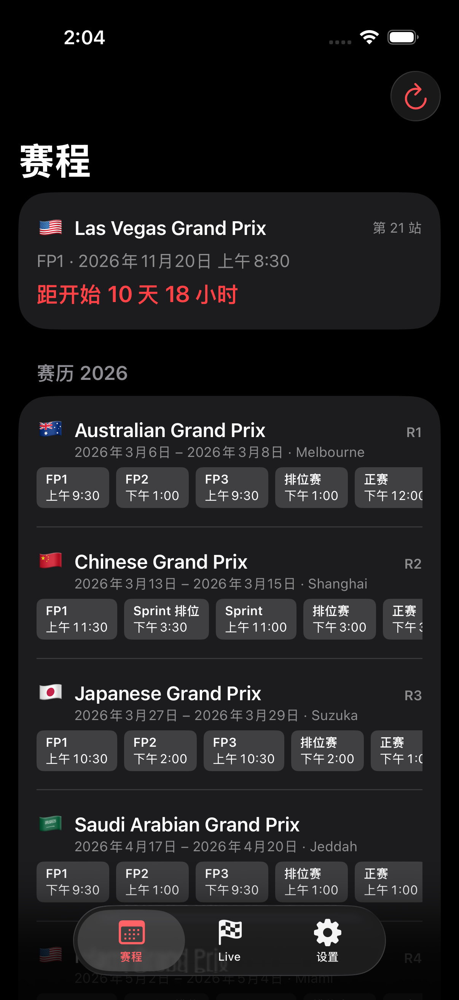
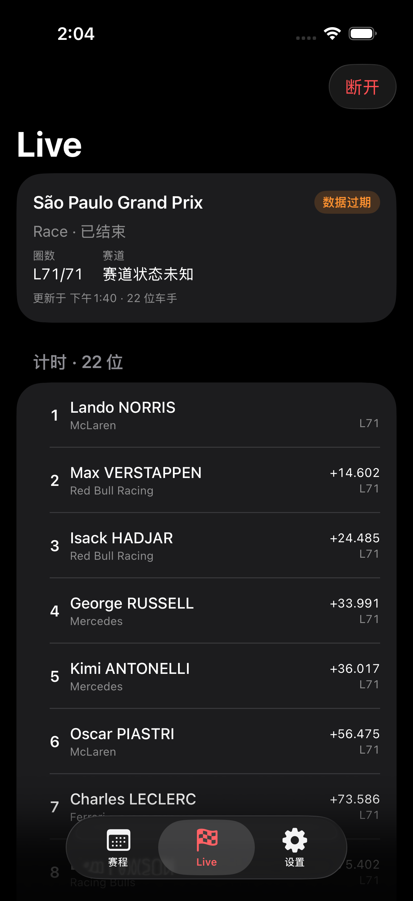
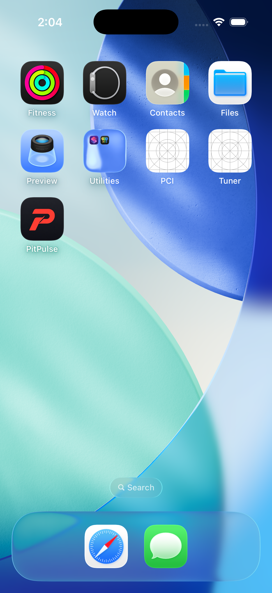

# iOS 26+ App 与灵动岛 Live Activity

> 状态：inReview。iOS 26 模拟器已完成 App、Widget Extension 与 Live Activity 构建、单元测试与运行验证；真机 Dynamic Island 仍需在具备开发者签名的设备上复核（见「限制」）。

## 目标

在不改动 Rust 服务端契约的前提下，把现有 macOS 数据层复用到 iOS，交付：

- iOS 26+ App：赛程表、Live 计时、设置三屏；
- 独立 Widget Extension，用 ActivityKit 提供灵动岛 / 锁屏 Live Activity；
- 三个独立本地 Swift Package（`PitPulseShared` / `PitPulseData` / `PitPulseComponents`，包名=模块名），由 `PitPulse.xcworkspace` 统一管理，供 macOS、iOS 与后续 watchOS 共享。

## 工程结构

```
PitPulse.xcworkspace                 # 工作区：管理一个 App 工程 + 三个本地 Package
├── PitPulse.xcodeproj              # 单一 App 工程（XcodeGen 由根目录 project.yml 生成）
│   ├── PitPulseDesktop             # macOS App：菜单栏 / Notch / 地图 / 设置
│   ├── PitPulseDesktopTests / PitPulseDesktopUITests
│   ├── PitPulseMobile              # iOS App：赛程 / Live / 设置
│   ├── PitPulseLiveActivity        # iOS Widget Extension：灵动岛 / 锁屏 Live Activity
│   └── PitPulseMobileTests
└── Packages/                        # 三个独立 Swift Package，包名 = 模块名
    ├── PitPulseShared/              # 纯值契约：FavoriteDriver、PreferenceKeys、WidgetContent、CountryFlag、LiveActivityAttributes
    ├── PitPulseData/                # APIClient、APIModels、LiveStore、SSE、Cache、Keychain、提醒、日历逻辑
    └── PitPulseComponents/          # 只吃值的 SwiftUI 原子视图（StatusPill、CountdownText、FlagBadge、LiveWidgetCard）
```

- 根目录 `PitPulse.xcworkspace` 管理单一 `PitPulse.xcodeproj` 与三个本地 Package；`PitPulseShared` / `PitPulseData` / `PitPulseComponents` 各自独立成包（包名即模块名）。
- 两端 App 的显示名统一为 **PitPulse**，并共用 `macos/Resources/AppIcon.icon`（Icon Composer）；构建产物分别为 macOS `PitPulse.app` 与 iOS `PitPulse.app`。
- `Components` 只依赖 `Shared`，不依赖 `Data`，避免 Widget 被拖入 URLSession / SSE / Keychain。
- 灵动岛契约 `PitPulseActivityAttributes` 位于 `Shared`，用 `#if os(iOS)` 隔离 ActivityKit，macOS 包编译不受影响。

## 关键实现

- App 由 `LiveStore` 驱动 SSE；`LiveStore.onSnapshot` 回调把快照交给 `LiveActivityController`。
- `LiveActivityController` 只在实际比赛进行中请求 `Activity`，按状态变化节流更新（SSE 可达数帧/秒）；重连中间的 `connecting` 快照不会错误结束活动。
- 灵动岛展示：紧凑态（旗帜 + 圈数）、展开态（赛事、领先车手、圈数、赛道状态、更新时间）；锁屏使用同一 `ContentState`。
- 无服务端改动：Live Activity 由 App 进程内更新，不需要 APNs；App 退到后台后活动保持最后状态，`staleDate` 90 秒标记过期。

## 验收证据

构建与测试（2026-11-09，Xcode 26.6，iPhone 16 Pro / iOS 26.5 模拟器）：

| 命令 | 结果 |
| --- | --- |
| `xcodebuild -workspace PitPulse.xcworkspace -scheme PitPulseDesktop build` | exit 0 |
| `xcodebuild -workspace PitPulse.xcworkspace -scheme PitPulseDesktop build-for-testing` | exit 0 |
| `xcodebuild -workspace PitPulse.xcworkspace -scheme PitPulseMobile build` | exit 0 |
| `xcodebuild -workspace PitPulse.xcworkspace -scheme PitPulseMobile test` | TEST SUCCEEDED，3 项通过 |

运行验证（真实本地服务 `http://127.0.0.1:38701`，2026 赛季 24 站数据）：

- 赛程屏：加载真实赛历、下一场倒计时（Las Vegas GP，FP1 2026-11-20）、按站列出 FP1–正赛时间。
- Live 屏：São Paulo Grand Prix 真实快照，22 位车手、L71/71、差距与圈数正常。
- 灵动岛：应用退到桌面后，紧凑态显示 `L32/71`（见下图）。







> 灵动岛截图为 `#if DEBUG` + `PITPULSE_DEMO_ACTIVITY=1` 的 QA 钩子生成的展示态（当时上游比赛已结束，无法从真实会话触发 Live Activity）。该钩子不编入 Release。

## 复现命令

```bash
# 重新生成工程（修改根目录 project.yml 后）
xcodegen generate

# 构建 / 测试 iOS
scripts/xcode-ios-task.sh build Debug
scripts/xcode-ios-task.sh test Debug

# 或通过 Taskdeck
taskdeck start --session PitPulse --task "Build iOS"
taskdeck start --session PitPulse --task "Test iOS"
```

## 限制与后续

- **真机验收未完成**：ActivityKit 在模拟器可运行，但签名、Always-On 与真机灵动岛布局需在设备复核（PP-34 的验收项）。
- **实时更新边界**：无 APNs，App 被杀后不再更新；真·实时需服务端新增推送（独立服务端任务，本次未做）。
- iOS 目标默认直连本机服务（`http://localhost:38701`）；`ServerAddress` 与 ATS 允许任意主机/IP 与 http(s)，公网部署建议 HTTPS。
- watchOS App 与 Watch Widget 未开始（PP-35）。
