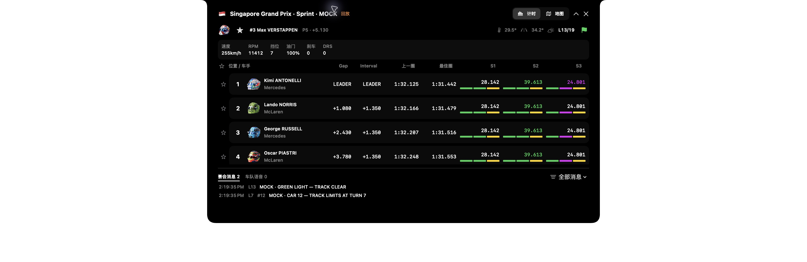
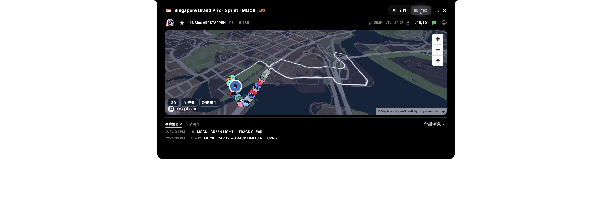
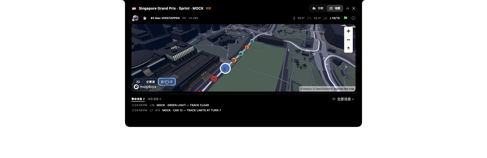
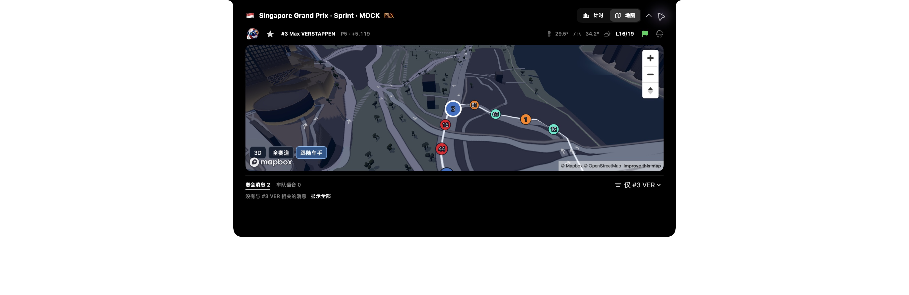

# Nook Live screenshot feedback verification

2026-10-11: scoped repairs to the existing main App, using the isolated Singapore 2026 Sprint synthetic replay. Mapbox resources are real; car motion, timing, weather and Race Control entries remain MOCK/replay. No audio fixture or paid subscription was added. Existing favorites and the ordinary server connection were preserved.

Changes and native observations:

- Max's `verstappen` roster ID now resolves the existing `max_verstappen` helmet asset. The actual header displays the helmet and #3 Max. Lindblad's known alias is handled by the same asset helper.
- The header has two rows: timing/map controls beside the title, then driver selection, air/track temperatures and lap/flag status. The weather button opens humidity, pressure, wind and rainfall details in a popover; opening/closing it was verified.
- Race Control/Radio tabs stay below the scrolling timing list/map, show counts and have an explicit All / Only #driver menu. Two mock Race Control entries are visible. Selecting Only #3 VER displays an explanatory empty state and Show All restores the entries. Radio's zero-count page explicitly states that this mock has no audio.
- The real WKWebView map loaded without the earlier Blob/image-resource error or retry banner. The bundled page continues to use a blank HTML origin, restricted navigation and the existing CSP.
- The whole circuit fits the map bounds. POI/place/road/transit and landmark icon labels are hidden while actual building/landmark geometry and attribution remain. Following Max sets zoom 16.5 and pitch 55 degrees; real 3D buildings were visible in the native view.
- Markers use team colors and racing numbers. The selected marker is larger, outlined in white and drawn above the others. Collision placement hides overlapping numbers; disabling symbol fades keeps moving numbers legible. Cars interpolate between received positions with a capped animation duration, obey Reduce Motion and stop their animation when paused. No native FPS or GPU benchmark was performed.
- Expanded Nook stays open on hover exit. Controller-owned mode, selected driver, message page/filter, map instance and camera survive expanded-view reconstruction. Native collapse/re-expand retained map mode, Max and Radio page. Native hide/reopen retained map mode, Max, the Only #3 filter, zoom/pitch and enabled following after loading a fresh web view. Hidden maps release their web view; configuration/geometry reload without losing the saved camera on the same server. Server/session changes still reset the camera.

Actual native screenshots (white margins are the window capture mask):

Checks in this repair pass:

- Final `xcodebuild ... build`: passed. `build-for-testing` compiled the new Swift test targets earlier in the pass; XCTest execution is not claimed.
- `sh macos/Tests/run-live-map-check.sh`: passed, using production models, MapStore and RadioPlayer. Includes same-server hidden release/configuration reload, stale response rejection, freshness, team colors, RC filtering and Radio cancellation.
- `node --test macos/Tests/map-page.test.mjs`: 5 passed. Includes frame interpolation, static-geometry reuse, camera restoration, collision/selection ordering, disabled symbol fades, follow zoom, 3D/no-POI configuration and error redaction.
- A standalone production asset-helper check resolved and decoded both existing Max/Lindblad PNGs.
- Rust formatting check, `git diff --check`, task-data validation and 8 task-data tests passed. This repair did not change server behavior.

Still open: full XCTest execution, a second display/floating layout and VoiceOver pass, real running-session vehicle positioning, Austin 2026 calibration, actual Radio playback and radar acceptance. Screenshot/live demonstration evidence does not close those requirements. State restoration is within the running App; restarting the process does not persist these transient display choices.
