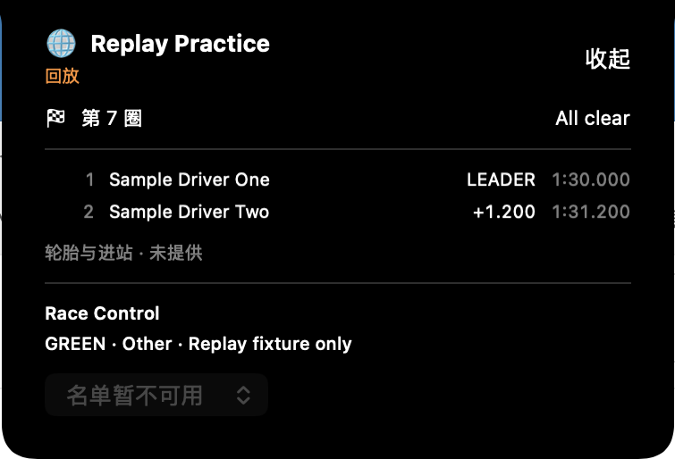
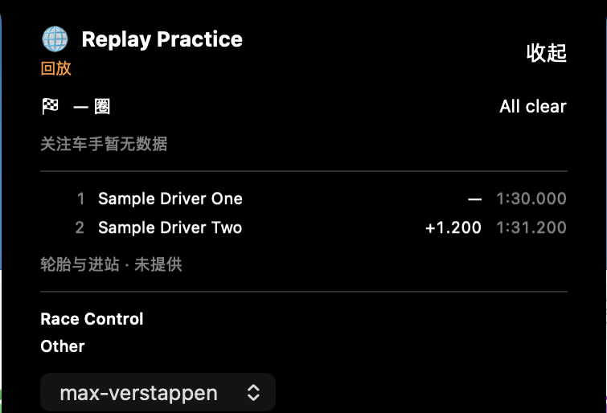

# Notch Live Island acceptance

Observed on macOS 26.5 with the T12 OpenNook revision pinned to `2b50b5c3a99df8914e25e199d29bf7aa505f7a59`. The production target remains a single `F1CompanionApp` and shares the existing `LiveStore`; the project and test targets require macOS 26.0. Replay traffic below is synthetic and binds only to loopback.

## Automated and visible evidence

- `xcodebuild -resolvePackageDependencies -project PitPulse.xcodeproj -scheme PitPulseDesktop` resolved the pinned OpenNook revision.
- `xcodebuild -quiet -project PitPulse.xcodeproj -scheme PitPulseDesktop -destination 'platform=macOS,arch=arm64' ONLY_ACTIVE_ARCH=YES CODE_SIGN_IDENTITY=- CODE_SIGNING_REQUIRED=YES build` passed on macOS 26.5.
- The serial `F1Companion` Xcode test run passed 69 tests, with 0 failures and 0 skips. This includes auto-show preference persistence, Session transitions and delayed-hide cancellation, unique full-name driver matching, stable favorite IDs without a roster, schedule association, and LiveStore/API decoding coverage.
- The `F1CompanionLiveAcceptance` UI scheme passed each of these real-app loopback tests individually, 1/1 with no skips: `testLiveIslandAutoShowsReplayAndExpands`, `testLiveIslandMissingFieldsUsePlaceholdersAndIgnoreUnknownRaceControlFields`, `testLiveIslandStaleRemovesTimingValues`, and `testLiveIslandDisconnectedRetainsSessionWithoutTimingValues`.
- Rust gates passed: `cargo fmt --manifest-path server/Cargo.toml -- --check`; `cargo test --locked --manifest-path server/Cargo.toml` (61 passed); and `cargo clippy --locked --manifest-path server/Cargo.toml --all-targets -- -D warnings`.
- The UI test runner in the current DerivedData build has a valid ad-hoc signature: `codesign --verify --deep --strict --verbose=2 <DerivedData>/Build/Products/Debug/F1CompanionUITests-Runner.app` passed. Run the runner through Xcode / `xcodebuild test`, rather than opening the `.app` directly in Finder. This verifies the local test artifact only; it does not claim Developer ID signing or notarization.

The explicit replay example accepts `normal`, `missing-fields`, `stale`, `disconnected`, `finished`, and `session-switch`. For example, launch `cargo run --locked --manifest-path server/Cargo.toml --example live_replay -- stale` before its matching UI test. It disables the real F1 provider and uses a temporary SQLite database; production failure paths do not start replay.

## Screenshots

These are cropped screenshots from the passing macOS 26.5 UI test runs, not SwiftUI previews.

| State | Evidence |
|---|---|
| Compact automatic presentation |  |
| Expanded timing and Race Control |  |
| Missing lap / gap, unknown Race Control field, and favorite without roster data |  |
| Stale: timing values removed |  |
| Disconnected: timing values removed |  |

The loopback calendar cannot reliably associate a country, so the compact capture uses the app's generic icon. Tire and pit-stop fields are unavailable in the current API contract and are labeled `未提供`. Stale and disconnected captures retain the known session and replay/degradation labels while removing lap, ranking, and gap values. Missing favorite roster data displays `关注车手暂无数据` and keeps the selected stable ID.

## Remaining desktop acceptance

The connected desktop reports a built-in notched display and an external HUAWEI display. The UI suite did not verify the no-notch fallback or display reconfiguration. The existing Menu Bar acceptance test can skip when macOS reports the status item outside the hittable area; it is not counted as a pass. These checks still need an interactive desktop run:

- Manual Menu Bar open/hide and Menu Bar data access while auto-show is disabled.
- Actual favorite switching with a populated roster; the replay used for fallback coverage has no standings roster.
- Session switch cleanup and the 30-second finished-session hide in a live UI run; current unit coverage verifies the delay and its cancellation/invalidation logic.
- No-notch display selection, hot-plug, scaling / resolution changes, focus retention, keyboard operation, and VoiceOver.

T14 stays `inProgress` until these checks have visible evidence. A green build, unit suite, or replay screenshot does not close the hardware and accessibility items above.

## Follow-up diagnostics and acceptance boundaries

The user prohibits changes to system display configuration. No hot-plug, mirroring, scaling or resolution operation is authorized. Read-only display inventory remains unchanged: the internal display is primary and both displays have mirroring disabled. The failed XCTest status-item click (`is not hittable`, AX frame outside the available screen area) is an automation-coordinate failure, not evidence of an App display defect. No display adjustment is an acceptance workaround.

Unified logging now traces LiveStore reception and Live Island decisions, panel geometry, screen candidates and focus changes. Reproduction and collection commands are in `macos/README.md`. Diagnosing AppKit and AX coordinates separately is required before another menu-bar click attempt.

Actual main-App favorite switching selected `Sample Driver Two` and displayed `P2 +1.200` using the stable roster ID; the screenshot is [favorite switch](assets/t14-verified/t14-favorite-switch.png). This proves the interaction with the synthetic roster only. New tests for finished/switch lifecycle and the command-line automatic-display Boolean fix require fresh runs; earlier passing counts above refer to the prior code revision.

### Diagnostics verification (2026-10-10)

- The updated main App built successfully. Serial `F1Companion` tests passed 71/71, with zero failures or skips (`xcodebuild ... -parallel-testing-enabled NO ... test`). Rust fmt, 61 tests and all-targets clippy passed again after the replay fixture changes.
- A real `log stream --level debug` captured `snapshotAccepted`, `automaticStarted` and `compact`. The panel selected the internal screen: AppKit frame `{{0, 584}, {1800, 585}}`, screen `{{0, 0}, {1800, 1169}}`, scale 2, safe-area top 38. The external candidate was `{{-1920, 0}, {1920, 1080}}`, scale 1, safe-area top 0. Automatic presentation reported `panelKey=false` and `appActive=false`.
- The first finished-session UI assertion failed because AX retained the ordered-out panel. The trace recorded the hide at approximately 30.10 seconds after scheduling, and the screenshot showed the panel absent. The assertion now checks whether its expand control is hittable, instead of equating AX object existence with visibility. The rerun also failed: AX continued to report the retained control as hittable after hide. This is an automation observability blocker; no further UI retry is justified until that boundary is repaired.
- A clean serial menu-bar run, with no manually launched App process, still reported AX status-item frame `(-4021, 7.5, 36.5, 24)` outside the screens. It failed before issuing a click and retained an AX diagnostic attachment. This remains an automation acceptance blocker, not a proven App display defect.
- A manually launched App overlapped with the earlier unit-test host; it was stopped. All subsequent App UI tests run without a manually launched main App and with parallel testing disabled. No unrelated user process was terminated.

The rerun log recorded `finishedHideScheduled` at 15:19:13.109, `finishedHideFired` at 15:19:43.169 and `hideCompleted` at 15:19:43.719 (local desktop time). After completion, `observedState=hidden`, `visible=false`, `panelFrame=none`, `panelVisible=false`, `panelKey=false` and `appActive=false`. AX existence and hittability are both insufficient hide assertions on this desktop. The UI method is still failing and is not counted as passing acceptance. Subsequent work must repair the observation boundary before resuming UI automation.

The diagnostic capture and replay server were stopped after collection; no manually launched App remains. There were no further attempts to alter system displays.

The cropped [finished stay](assets/t14-verified/t14-finished-visible.png) and [finished hidden](assets/t14-verified/t14-finished-hidden.png) captures show the actual panel before and after hiding. They are visual diagnostic evidence from the first failing test, not evidence that the XCTest method passed. The final diagnostic code built successfully after the `hideCompleted` logging addition.

### Native status-item diagnosis

A read-only native AX query with exactly one running main App confirmed the status-item position `(-4021, 7.5)`, the `AXPress` action, and no on-screen App windows with automatic presentation disabled. One native press before resuming CUA control returned success, but the resulting menu window was also off-screen at `(-4020, 41)`, size `430 × 560`; success of that action is not visible acceptance.

Read-only preference inspection then found `com.pitpulse.F1Companion-Item-0` in Bartender's active profile `Hide` list. The running Bartender 6 manages hidden menu-bar items; its [official documentation](https://www.macbartender.com/Bartender6/) describes temporary reveal by click, hover or gestures. Therefore the previously reported status-item coordinate is not merely an XCTest transform error. Access must use the existing reveal workflow; do not rewrite the user's Bartender profile, terminate the manager, or change displays to expose the item. The CUA-selected helper and Finder desktop provided no visible status-item control, so no coordinate was guessed.

### Revised lifecycle observation

The Session-switch trace initially jumped from version 1 to version 3 without scheduling a finished-session hide. Production SSE publishes periodic snapshots (15 seconds in this example); the old fixture switched from Started to Finished to a new Started Session inside ten seconds. That fixture could not prove cancellation. The example now holds Finished for the snapshot interval plus five seconds before publishing the new Session, with a runtime assertion that the hold exceeds the clamped SSE interval. The production API and SSE behavior remain unchanged.

UI lifecycle visibility now uses WindowServer's on-screen windows for the sole main-App PID and the panel layer configured by the pinned OpenNook (`statusBar + 8`). This checks a rendered native panel independently of controller flags and retained AX objects. The ended-session assertion also checks that the App is still running; disappearance caused by a crash cannot pass. AX continues to supply content and button interaction. The revised tests have not yet passed at the time of this note.

### Session-switch acceptance result

The revised `testLiveIslandSessionSwitchCancelsOldFinishedHide` passed 1/1 with zero skips. The single main App received version 2 at 15:32:55.347 and scheduled a finished hide, then version 3/new Session at 15:33:10.350. The screenshot and WindowServer assertion after the additional 32-second wait prove the new Session remained visible beyond the old 15:33:25 hide deadline: [Session switch](assets/t14-verified/t14-session-switch.png). Earlier failed/insufficient fixture observations above are retained.

The user then closed Bartender themselves. A clean serial menu-bar run changed the AX status-item frame to `(-770, 30, 36.5, 24)` but still reported not hittable. The test stopped before clicking; it remains 0/1, no skips. This narrows but does not resolve the menu-bar observation boundary. No display configuration was modified.

Requirement review found degraded compact content still announced lap/position/gap placeholders. Those fields and their accessibility text are now removed entirely when stale/disconnected, preserving the Session and replay/degradation label. Fresh connected missing-field placeholders remain. New UI assertions and screenshots require fresh verification.

The degraded-label unit rerun passed 70/71; the sole failure was the pre-existing backoff test's count-after-sleep assertion (`2` instead of `1`). Its fixed sleep cannot bound scheduler delay. The test now records monotonic request timestamps and checks each actual retry interval is at least 0.4, 0.8 and 1.2 seconds, then checks recovery; production retry behavior is unchanged. The replay server was stopped before the complete serial rerun.

### Final lifecycle and retry verification

The complete serial unit rerun passed 71/71 with zero failures or skips after replacing scheduler-sensitive retry sleeps with actual monotonic request intervals. Rust all-target tests passed 61 tests; fmt and all-target clippy passed.

`testLiveIslandFinishedHidesAfterThirtySeconds` now passed 1/1 with zero skips using WindowServer visibility and asserting exactly one main App and at most one rendered Nook. The log scheduled hiding at 15:46:06.863 and fired at 15:46:36.894, a 30.031-second interval. Automatic refresh and hiding retained `panelKey=false` and `appActive=false`. Passing-test captures: [brief stay](assets/t14-verified/t14-finished-verified-visible.png) and [hidden](assets/t14-verified/t14-finished-verified-hidden.png).

The manual App was stopped before the fresh degraded-state UI runs. CUA binding the existing App returned `timeoutReached`; repeating ungrounded menu clicks or changing system displays is not an acceptance strategy.

### Degraded-state harness corrections

The native arm64 stale run passed 1/1, but its capture caught OpenNook's content blur transition and is not accepted as a final screenshot. The disconnected run failed because pointer hover had already expanded the panel; querying every expanded paragraph for the word “圈” also matched explanatory fallback text. Tests now collapse an already expanded panel, inspect the actual compact button's accessibility label, and capture after the public transition has settled. Both states need fresh runs. The initial generic build selected x86_64 and could not import the arm64-built NookApp module; native runs explicitly pass `ARCHS=arm64 ONLY_ACTIVE_ARCH=YES`. No App or display workaround was introduced.

The corrected disconnected run passed 1/1 with no skips. It proves compact timing accessibility fields are absent, expanded timing/Race Control values are removed, the known Session is retained, and replay and disconnected labels coexist. Stable screenshots: [compact](assets/t14-verified/t14-disconnected-compact-labels.png), [expanded](assets/t14-verified/t14-disconnected-labels.png). A prior immediate AX assertion during expansion failed; it now waits for the expected Session text. Each one-shot disconnected scenario requires a fresh replay process.

The fresh stale run also passed 1/1, zero skips, with stable [compact](assets/t14-verified/t14-stale-compact-labels.png) and [expanded](assets/t14-verified/t14-stale-labels.png) captures. Both revised degradation states now have real screenshots and content assertions. The keyboard run initially hit the same already-expanded hover state; its normal-state setup now explicitly compacts before capturing or clicking Expand.

### Keyboard and accessibility follow-up

The final native serial `testLiveIslandAutoShowsReplayAndExpands` passed 1/1 with zero skips. It captured actual compact and expanded content, then sent Escape to the explicitly focused expanded panel and verified compact controls returned. Latest screenshots: [compact](assets/t14-verified/t14-compact-final.png), [expanded](assets/t14-verified/t14-expanded-final.png), [Escape](assets/t14-verified/t14-keyboard-escape.png).

CUA also opened the main App's Settings through its actual application menu, toggled `Session 期间自动显示 Notch` off and on, observed both values, and restored the requested default on. This is real preference interaction; it does not close the separate status-item open/hide requirement.

VoiceOver was initially off. The requested accessibility test enabled it through Accessibility > VoiceOver, accepted Use VoiceOver, closed the first-use tutorial, and verified the real VoiceOver and ScreenReader processes ran. Main-App expanded content and favorite/collapse accessibility controls were observed with VoiceOver active. A Control-Option-Right navigation attempt did not produce observable VoiceOver cursor or speech evidence in the available tool, so full VoiceOver navigation is not counted as passed. VoiceOver was restored to off and verified in Settings. No display preferences were changed.

The status-item AX coordinate and manual menu proof remain unresolved. Stop repeating unsupported status-item clicks. Actual no-notch, hot-plug, scaling/resolution checks remain unverified under the user's prohibition on changing system displays. These limitations prevent T14 from being marked done.

Repeatable native UI commands use `xcodebuild -project PitPulse.xcodeproj -scheme PitPulseLiveAcceptance -destination 'platform=macOS,arch=arm64' ARCHS=arm64 ONLY_ACTIVE_ARCH=YES -parallel-testing-enabled NO -only-testing:PitPulseDesktopUITests/MenuBarAcceptanceTests/<method> test`, with one fresh loopback replay example for each one-shot failure scenario. Main-App launches and XCTest hosts must never overlap.

### Cleanup

After acceptance, the sole manually launched test App and loopback replay were stopped. Process checks found no F1Companion, live_replay, xcodebuild or VoiceOver engine remaining. The synthetic `sample-one`/`sample-two` favorite preference was removed only when it matched those fixture IDs; real driver IDs were untouched. Automatic display was restored to on. System Settings was returned to its original General page. No commit, push or publication was performed. Task-data validation passed 8/8 and `git diff --check` passed.

### Existing external display acceptance

A Debug-only `PITPULSE_ACCEPTANCE_SCREEN=external` screen-provider override selects an already connected external screen with no notch. It uses OpenNook's public screen-provider and automatic presentation interfaces, retains one main App/panel and the shared LiveStore, and changes no system display configuration. Release and default Debug behavior retain the required built-in-notch-first selection. The new real UI test fails rather than skips when the hardware is absent, checks one on-screen panel, checks content belongs to the external screen and sits below its menu bar, and captures compact and expanded floating content. This test is pending; it cannot stand in for hot-plug or resolution-change acceptance.

The first external-screen test failed: the project did not define Swift's `DEBUG` compilation condition, so the conditional override was absent and the panel stayed on the internal screen. Debug now explicitly defines `$(inherited) DEBUG`; Release has no override. The fresh `testLiveIslandFloatingOnExistingExternalDisplay` passed 1/1 with no skips. It verified one main App, one on-screen Nook, the actual external screen bounds and content below its menu bar. Actual screenshots: [floating compact](assets/t14-verified/t14-external-floating-compact.png), [floating expanded](assets/t14-verified/t14-external-floating-expanded.png). This closes the real no-notch floating screenshot requirement without changing system displays. Hot-plug, scaling and resolution changes are still unverified.

A new read-only native AX observation with one background main App found its Cache status item at `(1003, 7.5, 36.5, 24)` on the primary display, while the floating panel was actually at `(-1920, 89, 1920, 540)` on the existing external display. This contradicts a blanket claim that every status item remains off-screen. The manual-menu XCTest setup explicitly called `app.activate()` before reading the item; that activation is unnecessary for an LSUIElement status menu and was removed for one evidence-driven rerun. The menu requirement remains pending until the rerun passes.

The background-menu rerun opened the real Popup with auto-show off, manually expanded Live Island and switched to the stable Sample Driver Two ID successfully. It then failed to reopen the menu while expanded. AX now located the item on the primary screen at `(1051, 7.5, 36.5, 24)`, overlapping the expanded panel; this is a layout/hit-testing issue rather than the former off-screen AX failure. WindowServer reports the native Menubar at layer 24; the pinned Nook defaults to statusBar + 8 (33). The integration now uses OpenNook's public `configureWindow` to set the panel's level to `.floating`, below the native menu bar. The rendered-panel test observer follows the configured floating level. Menu interaction and actual compact/expanded content are being verified together; this change is not accepted until screenshots remain correct and interactions pass.

The lower `.floating` window-level experiment failed actual expansion and status-menu assertions, so it was reverted. The rendered-panel observer again checks the pinned statusBar + 8 level. This attempted layout fix is not counted as acceptance. The explicit compact button and manual menu-opening path now activate the App before taking keyboard focus; only those user actions do so. Automatic presentation, hover callbacks and live refresh remain nonactivating. This addresses the observed distinction between a key panel and an inactive App during VoiceOver testing and requires verification. Debug also uses `ONLY_ACTIVE_ARCH=YES`, matching SwiftPM's native Debug artifacts without forcing Release architecture.

### Latest explicit expansion and desktop automation stop

The latest `testLiveIslandAutoShowsReplayAndExpands` passed 1/1, zero skips, exit 0 after the explicit-user-action focus change. The command was `xcodebuild -project PitPulse.xcodeproj -scheme PitPulseLiveAcceptance -destination 'platform=macOS' -parallel-testing-enabled NO -only-testing:PitPulseDesktopUITests/MenuBarAcceptanceTests/testLiveIslandAutoShowsReplayAndExpands test`; Debug's active-architecture setting resolved the previous generic-destination import failure. This pass does not close full menu coexistence or VoiceOver navigation.

The user reported that the acceptance automation was taking their mouse. This is interference caused by the agent's desktop automation, not evidence of a system display fault. All desktop interaction, UI tests, App launches and system-setting operations have stopped. The manually launched App and loopback replay were terminated; read-only process checks found no F1Companion, xcodebuild, live_replay or VoiceOver engine running. No further CUA or settings operation was used to finish cleanup.

The latest VoiceOver attempt temporarily enabled the preference but did not establish working navigation. Its final preference state was not verified after desktop automation stopped; earlier restoration evidence applies only to the earlier run. Do not claim the latest preference was restored. Existing screenshots and passing results remain evidence of their specific runs. Menu reopening, full VoiceOver navigation and display-change acceptance remain unverified; T14 is not done. Further work is restricted to terminal checks that do not launch the App or drive the desktop, code review and records.

### Terminal-only current build

After stopping desktop automation, `xcodebuild -project PitPulse.xcodeproj -scheme PitPulseDesktop -destination 'platform=macOS' build` exited 0 with `BUILD SUCCEEDED`. This compiled the current App and pinned dependency without launching the App or a test host. Current source review confirms activation is confined to the explicit compact button and manual menu expansion; automatic presentation, hover callbacks and refresh contain no activation call. This source check is not new runtime focus or menu acceptance. The README now explicitly distinguishes compilation from tests that drive the user's mouse and keyboard. No further desktop interaction occurred.

### Acceptance blocked under current desktop constraint

After three consecutive checks of the same desktop-interaction constraint, compilation and records are complete but the remaining real menu, VoiceOver and display-change requirements are still unproven. A fresh read-only process query found no App, xcodebuild, replay or VoiceOver engine, so there is no live acceptance job to wait for. T14 is recorded as blocked. Repeating builds cannot replace missing runtime evidence; desktop automation and system-setting operations remain stopped.

### User-operated remaining acceptance

At the user's request, the current Debug main App was opened in the background using `open -g`; process inspection confirmed exactly one F1Companion process. No UI automation, replay server, display override or settings operation was started. It uses the user's existing connection and preferences. This launch is not acceptance of any remaining requirement.

Remaining manual checks:

1. Open the menu-bar item, choose “显示 Live Island”, and reopen the menu while the panel is expanded. Confirm both surfaces are usable; “隐藏 Live Island” hides the panel and leaves menu-bar data available. Menu reopening while expanded is the previously failing check.
2. In Preferences, disable “Session 期间自动显示 Notch”. Confirm menu data and manual opening still work, then restore the preferred value. Select a favorite in the expanded panel and verify it persists after hiding and reopening; if Live is unavailable, “关注车手暂无数据” is expected rather than invented position/gap.
3. While typing in another App, check that automatic presentation, hover expansion and refresh do not move keyboard focus. Explicitly click Expand and check keyboard navigation and Escape to compact. Automatic-presentation proof needs an actual Started event; without it that part remains unverified.
4. If using VoiceOver, navigate the panel's Session, state labels, favorite selector and collapse button. Confirm announcements and keyboard actions; enabling VoiceOver and restoring its preference are user actions only. AX labels alone do not prove this requirement.
5. Only if the user chooses to change their own displays, verify hot-plug, resolution and scaling changes leave one panel on the intended screen, below the menu bar where floating, with readable scrollable content. Otherwise these checks remain unverified. The agent will not change display settings.

Passing reports and any screenshots must be recorded before closing these items. Existing loopback evidence covers degradation and lifecycle scenarios; the running App has not been forced into replay and makes no guarantee that real Live is available.

### Explicit reopen entry correction

The first background launch left only a status-item process and no visible panel. The user's report correctly exposed that checking a PID does not prove a usable visible entry. Logs showed disconnected/server-unavailable, so no automatic Started presentation occurred. The App delegate now posts an explicit reopen request; the existing Live Island controller handles it by manually opening only when hidden. Reopening does not toggle an already visible panel closed. Automatic/hover paths are unchanged.

The current main App rebuilt successfully. Only the previously agent-launched process was terminated, then the rebuilt App was opened and explicitly reopened with LaunchServices. Exactly one main-App process remained. The new process logged manualToggle and expanded; subsequent panelFocusChanged reports expanded, panelVisible=true and panelKey=true. This is a user-requested open, not automatic focus acceptance. A notification unit test was added but not executed because running an App-host test is currently prohibited; no UI automation was used. The connection remains unavailable and no replay was started. User-visible confirmation and the remaining manual checks are still pending.

### Main server started for user acceptance

The user correctly identified that the running App also needed its server. The normal `pitpulse-server` binary was started with `cargo run --locked --manifest-path server/Cargo.toml --bin pitpulse-server`, loopback bind `127.0.0.1:38701` and a database outside the repository. No fixture or replay server was substituted. Startup reported HTTP ready and a refreshed 2026 calendar with 24 meetings. GET `/api/v1/health` returned HTTP success with status=ok, database=true, live=false. GET `/api/v1/live/snapshot` returned sourceMode=live, sourceStatus=disconnected and statusReason=upstream_handshake_failed.

The existing sole App automatically reconnected without UI actions: LiveStore accepted versions 4, 5 and 6 at 16:42:14–16:42:20 Asia/Shanghai, sourceMode=live and sourceStatus=disconnected. This proves the App-to-local-server connection, not real upstream timing availability. The server is intentionally left running for the user's manual acceptance. No mouse, keyboard automation or system settings were used.

### User screenshot product corrections

The four user-supplied captures expose product defects, not an environment failure: [home](assets/t14-user-feedback/home-before.png), [calendar](assets/t14-user-feedback/calendar-before.png), [results](assets/t14-user-feedback/results-before.png), [standings](assets/t14-user-feedback/standings-before.png). They are before-change evidence. Older successful screenshots do not prove these newly changed surfaces pass.

- Home now chooses a noncancelled meeting in the current calendar week, or the nearest known meeting when no race falls in that week. It remains available after the final Session starts, lists the complete weekend, dates/location and next Session countdown, and places revision/source/fetch diagnostics in a disclosure. The main navigation says “比赛”.
- The menu status-item glyph is fixed to PitPulse's checkered flag. Connection state remains inside the Popup. The Popup uses a neutral native window background with consistent margins and a larger 480 × 640 layout.
- OpenNook's pinned source explicitly defers hide while `.keepVisible` and pointer hover are both true. The integration removes this public hover flag so explicit hide cannot wait indefinitely under an overlapping pointer. The controller updates visibility at the request and the expanded panel has a separate Hide control. This root-cause fix has compiled but still needs the user's actual click confirmation.
- Calendar includes weekend dates and starts at the current/nearest meeting. Results and standings reuse the existing scoped overlay/autohiding small scroller; native system scroll settings are untouched. Rows have additional vertical space. Existing result fields open in a dismissible detail sheet; driver/team standings open in summary detail sheets. Missing metrics remain “—”; per-race standings detail is explicitly unavailable because the API does not provide it.
- Island uses a calendar-associated hosting-country flag for a known upcoming plan and the PitPulse symbol when no reliable association exists. No globe is used in its content. Without fresh Live it shows weekend context, planned Session times and a per-second countdown. Fresh snapshots still drive Timing, track state, favorite and Race Control through the same LiveStore. This does not repair upstream availability or invent realtime data.

Verification: main App build passed; `F1Companion` and `F1CompanionLiveAcceptance` build-for-testing both passed without launching any App/test host. A terminal Swift executable compiled the actual API models and CalendarLogic and passed six assertions: current-week preference, recently ended fallback, nearer future fallback, season-end fallback, cancellation exclusion and empty data. Two CalendarLogic XCTest cases were added; the XCTest/UI suites were not run because desktop automation remains forbidden. Existing UI tests were adapted for “比赛”, disclosed provenance and year-arrow navigation, but have not been rerun. No server files or T12/T13 histories changed for these product fixes.

The corrected App was then started as the sole main-App process, with the normal server still healthy. Its log accepted live-mode version 18 and recorded explicit manual expansion with panelVisible=true at 17:07:23 Asia/Shanghai. This is launch/connection evidence only; the new Popup layouts, detail sheets and explicit hide click still require the user's review. Task validation passed 8/8 and git diff --check passed.

### Sprint Live, helmets and S1/S2/S3 correction

The user's two reference images requested a wider timing view with helmets and three sectors (confirmed as S1/S2/S3), plus compact race state and favorite live timing. The implementation and real connection results are in [Live connection correction](live-cookie-transport.md). This supersedes the earlier current-state assertion that upstream was unavailable; the previous evidence remains historical. The normal server now receives live-mode Started, 22 drivers, growing versions, changing laps and sector times. The rebuilt sole main App received Started and automatically presented without becoming active/key.

The expanded view uses the existing bundled helmets via unique full-name roster identity, adds gap/interval, last/best lap and three sector times/colored segments, and is 860 wide with bounded scrolling. The compact view includes favorite identity and Session state. Missing fields stay unavailable, and stale/disconnected paths continue to remove timing. New build and protocol/logic checks are not visual acceptance. The user will operate the App; no automation, display change or extra App was launched.

### Kimi Antonelli identity correction

The user confirmed that Kimi's helmet was present in Menu Bar but absent in Live. The normal API showed `name=Kimi ANTONELLI`; the existing roster used stable ID `antonelli` and `Andrea Kimi Antonelli`, with a bundled `helmet-antonelli-2026` asset. This was a name-matching defect, not a missing asset. Mercedes' [official driver profile](https://www.mercedesamgf1.com/drivers/driver/andrea-kimi-antonelli) explicitly identifies Andrea Kimi Antonelli as commonly known by his middle name.

The shared Live identity matcher now canonicalizes only this verified complete alias pair. Both helmet lookup and favorite timing selection retain unique matching and the saved `antonelli` ID. Surnames, partial names, car number, position and team do not become identity guesses; duplicate canonical names still return no match. Calendar and Session-name normalization are unchanged. A regression test covers helmet and favorite matching, ambiguity on both sides and partial-name rejection. The actual Swift logic passed 20 terminal assertions (six new); desktop XCTest/UI automation was not launched. Build results and actual launch are recorded below when observed.

Kimi correction verification: `xcodebuild -project PitPulse.xcodeproj -scheme PitPulseDesktop build-for-testing` and `build` both succeeded. The corrected sole main App was relaunched in the background; at 09:45:59 UTC it logged `automaticStarted` and `compact`, automatic=true, panelKey=false and appActive=false. The same existing server remained healthy with live=true. Task validation passed 8/8 and `git diff --check` passed. These observations confirm the new App is running and receives Started; Kimi's rendered helmet and favorite interaction still await user-operated visual confirmation.

### Track condition colors and direct follow controls

The user requested prominent SC/VSC/red-flag context and reported poor favorite selection usability. At the start of this change the normal server returned `trackStatus=SCDeployed`, sourceStatus=connected, lap 5/20; later it returned `AllClear`, lap 9/20. This is actual existing TrackStatus input, not a simulated flag or a new Topic.

The compact and expanded views now share a text-and-color badge: clear green, yellow flag/SC yellow, VSC/ending transitions orange, red flag red and unknown/unavailable gray. Numeric states 1/2/4/5/6/7 and normalized producer messages are supported; unrecognized messages remain unknown. A VSC ending message does not become green until an actual clear state arrives. Stale/disconnected data cannot supply a current colored flag. Fresh red-flag data labels an otherwise Started Session as paused. The expanded Session header, track badge and favorite controls stay above the scrolling timing list. Labels and accessibility announcements identify conditions independently of color; no blinking animation was introduced.

The favorite menu is visible at the top, with current helmet/name, position/gap and a clear action. Each uniquely identified timing row has a star and a keyboard-accessible button: select to follow, select again to clear, select another row to switch. Both roster and current Live identity must be unique before saving the existing stable ID; missing/ambiguous identity disables that row's selection rather than guessing. The compact favorite area also opens the expanded selection view. Native menu tracking temporarily sets OpenNook's public `staysExpandedOnHoverExit` so leaving the panel to choose a menu item does not trigger hover-exit collapse; end tracking restores the normal behavior. These notifications do not request App activation or keyboard focus.

Regression checks cover flag codes/messages, unknown/missing flags, stale/disconnected suppression, red pause and direct-row identity uniqueness. Existing preference persistence is reused; an additional AppModel test checks switch and clear but will only be compiled, as App-host/UI testing is prohibited. Actual menu tracking, click behavior, colored presentation and VoiceOver still require user-operated confirmation. No server code, connection, system setting, mouse or keyboard automation was changed for this update.

Track/follow verification: the terminal executable compiled the actual APIModels, CalendarLogic, LiveModels and LiveIslandLogic and passed 42 assertions (22 new checks beyond Kimi correction). `xcodebuild -project PitPulse.xcodeproj -scheme PitPulseDesktop build-for-testing` and `build` both succeeded; no XCTest host or UI automation ran. The added AppModel switch/clear test compiled but was not executed. Task data tests passed 8/8 and `git diff --check` passed. Only the existing main App was restarted with LaunchServices in the background; the server was kept running throughout. Content diagnostics now include a fixed semantic track condition, and preference changes log only selected/matched booleans, without driver names, credentials or payloads. Actual colored rendering, direct-row follow, cancel/switch and native-menu behavior remain user-operated acceptance items.

Actual track/follow build launch: at 09:59:25 UTC the sole rebuilt main App accepted connected/live snapshot version 9420 with 22 drivers, logged `track=clear`, panelKey=false/appActive=false, and automatically presented for Started. The existing server remained health=ok/live=true. This verifies the updated status mapping is receiving real input; it is not a screenshot or proof of mouse/VoiceOver behavior.

### Icon presentation correction

The user rejected the text badge presentation. Both compact and expanded track indicators now use native SF Symbols without a text capsule: green/yellow/red filled flags, a yellow filled car for SC, an orange outline car for VSC, and a clock corner mark while either car state is ending. Unknown or unavailable track state stays gray, with no retained fresh flag color. Full state names remain in hover help and accessibility labels, so color is not the only way to identify a state.

Favorite selection uses a star menu, cancellation uses a crossed-out star, and collapse uses a chevron. Inline action instructions were removed. The selected driver's helmet/name, position/gap, timing table, explicit replay and unavailable-data labels remain. Native menu items still show driver names for selection; row selection continues to save the existing stable ID. No focus, lifecycle, server, transport or system display settings changed.

Verification: the terminal executable compiled the actual API models, CalendarLogic, LiveModels and LiveIslandLogic and passed 50 assertions, including all eight track icon mappings. A separate AppKit check resolved all ten SF Symbols used by these controls on the installed macOS, without launching an App or manipulating the desktop. The new XCTest icon case is compiled only; no App-host/UI test is launched. Visual readability, icon recognition, actual clicks and VoiceOver remain manual acceptance items.

Both sequential compile commands passed: `xcodebuild -project PitPulse.xcodeproj -scheme PitPulseDesktop -destination 'platform=macOS' -parallel-testing-enabled NO build-for-testing` returned `TEST BUILD SUCCEEDED`; the same project/scheme/destination with `build` returned `BUILD SUCCEEDED`. Compilation does not constitute XCTest execution or UI acceptance.

Only the existing main App was terminated. The first immediate background reopen returned LaunchServices error `-600` while the old process was exiting; retry after confirming its exit succeeded. Exactly one main App and the unchanged server remained. At 2026-10-10T10:57:43Z, the rebuilt App accepted real live snapshot version 12493, 22 drivers, track=yellow, with panelKey=false and appActive=false. The upstream Sprint was already Ends at 20/20 laps, so the Island followed its end-session hide path rather than presenting a fabricated running race. At 10:58:22Z, version 12494 became stale and the App removed the old track color (track=unknown). Its loopback connection remained established. Use the Menu Bar manual Live Island entry to inspect the icon presentation; no automatic click, screenshot or visual acceptance was performed.

Task data validation and its eight tests passed. `git diff --check` passed. No Rust files changed for this icon-only correction, so the earlier Rust checks were not repeated.


## 21:00 排位赛仍显示旧 Sprint：修正记录（2026-10-10）

用户修正前截图见 [导航文字](assets/t14-user-feedback/20261010-navigation-labels.png) 与 [旧 Sprint/断开](assets/t14-user-feedback/20261010-old-sprint-session.png)。顶部四项导航已改为纯图标，保留各项悬停提示、辅助功能名称和选中状态。

13:02Z 正常 REST 的真实源仍是 Session 11383 / Sprint / Ends / disconnected，最后 transport 为 12:58:05Z；已有赛历明确 Session 11384 / qualifying 的起止为 13:00Z–14:30Z。旧 Island 优先保留旧 Live 的 SessionName，且旧结束收起任务未及时让位。

现在纯展示逻辑在 Live 不可用或上一 Session 已结束时，以唯一有完整起止区间的当前赛历显示“预计 排位赛 / Live 不可用”，清掉圈数、排名、gap、赛道状态和旧收起计时器。每秒检查会话边界，真实活跃 Live 优先；回放不按现实赛历切换，缺结束时间或多个匹配不猜测。没有把赛历开始时间变成 Started。

服务器修正两项：成功收取有效 Live 数据后清零重连失败计数（之前累计到 300 秒等待）；cookie 传输收到 SignalR type6 心跳后只推进 lastTransportAt，不刷新 updatedAt/计时数据或解除 stale。静默断开的原因保留 upstream_silent，日志只记心跳事件/会话 ID 与重试时长。生产仍使用相同八个 Topics，不进入回放。

实际日志 13:09:06Z 静默重试为 5 秒，13:09:17Z 订阅恢复；更新传输后 13:10:30Z 首次确认实际收到传输心跳，REST lastTransportAt 随心跳推进而 updatedAt 保持 13:10:16Z。这时真实订阅仍只有 Sprint Ends，没有实际排位赛 Timing 数据，不能声称已恢复排位赛 Live。

Xcode 主 App build 通过；79 项 Rust 全套测试、严格 all-targets Clippy、debug build 与 fmt 通过，新增“传输心跳防止误断但不刷新过期计时”1 项定向回归通过。独立执行真正的 LiveIslandLogic 源码，覆盖时间边界、旧 Session Ends、stale/disconnected、无结束时间、重复赛历、真实 Live 优先、回放保护。命令：

```sh
swiftc macos/Core/APIClient/APIModels.swift macos/Core/Models/CalendarLogic.swift macos/Core/LiveStore/LiveModels.swift macos/Features/LiveIsland/LiveIslandLogic.swift macos/Tests/Headless/IslandSessionChecks.swift -o /tmp/pitpulse-island-session-checks
/tmp/pitpulse-island-session-checks
cargo test --locked --offline --manifest-path server/Cargo.toml
cargo test --locked --offline --manifest-path server/Cargo.toml test_transport_heartbeat_prevents_disconnect_without_refreshing_stale_timing
cargo clippy --locked --offline --manifest-path server/Cargo.toml --all-targets -- -D warnings
cargo build --locked --offline --manifest-path server/Cargo.toml
cargo fmt --manifest-path server/Cargo.toml -- --check
xcodebuild -project PitPulse.xcodeproj -scheme PitPulseDesktop build
```

只替换现有正常服务器 job，旧 App 退出后后台启动唯一新版。没有操作鼠标/键盘/系统显示，也未运行 App-host/UI 测试；截图只来自用户修正前反馈。T14 实际交互与真实排位赛 Live 仍未计为通过。

最终正常服务器观测 2026-10-10T13:12:57Z：Session 11383 / Sprint / Ends，sourceStatus=stale、statusReason=data_stale；计时数据已 161 秒未变，lastTransportAt=2026-10-10T13:12:49Z 仍随心跳更新。已超过旧 120 秒误断点，连接没有误断；一主 App、一正常服务器。任务数据校验与 8 项数据测试通过，diff 检查通过；尚无排位赛实时数据证据。


## 主界面状态文案清理（2026-10-10）

用户反馈截图见 [常驻状态文字](assets/t14-user-feedback/20261010-status-text.png)，仅为修正前反馈，不计为新版 UI 验收。主菜单标题仅显示 PitPulse；在线、过期、Live 状态及最近成功时间收进底部信息图标的连接详情。缓存来源与质量保留在主动展开的“数据详情”，不作为常驻标题。赛历去掉“即将开始”“已到计划时间”，保留取消/延期等实际安排变化。赛后及积分分析加载只显示原生进度指示，错误和重试入口保留。

Island 的赛历会话标题去掉“预计”，显示会话名。无新鲜 Live 数据时使用小型原生等待动画，Reduce Motion 下为静态省略号；赛历来源、等待原因和真实状态留在悬停提示及辅助功能。旧圈数、排名、gap 与赛道旗色仍被移除，赛历时间不会被映射为 Started。展开时保留赛事/场地/赛历，无数据提示段落去掉；回放在主菜单和紧凑/展开 Island 中仍明确显示“回放”。车手匹配不到用问号人物图标，完整说明保留在 help 与辅助功能标签。

验证命令实际成功：

```sh
xcodebuild -project PitPulse.xcodeproj -scheme PitPulseDesktop build
swiftc macos/Core/APIClient/APIModels.swift macos/Core/Models/CalendarLogic.swift macos/Core/LiveStore/LiveModels.swift macos/Features/LiveIsland/LiveIslandLogic.swift macos/Tests/Headless/IslandSessionChecks.swift -o /tmp/pitpulse-island-session-checks
/tmp/pitpulse-island-session-checks
```

主 App BUILD SUCCEEDED；独立检查覆盖排位赛标题、开始边界、旧结束/过期/断开、缺结束时间、重复赛历、真实 Live 优先与回放。旧 App 完全退出后 open -g 后台启动，确认唯一主 App；正常服务器保持原进程，未重启、未用回放替代。无鼠标/键盘/系统设置操作，无 App-host/UI 测试、自动截图或实际视觉验收。此次未改 Rust 代码，不重复此前 Rust 门禁。

13:19:05Z 正常服务器 health=ok/database=true/live=true，源已切到 Session11384/Qualifying，sourceMode=live/sourceStatus=connected，updatedAt=13:18:02Z、lastTransportAt=13:18:54Z。快照22行均有名次，lapCount 缺失、trackStatus=Yellow，SessionStatus=Inactive。旧 Sprint 阻塞已改变，但此观测不能证明 Started 或持续逐圈更新；不得把未知圈数编造为新比赛进度。任务仍 inReview，实际新版视觉/点击和原显示器、VoiceOver验收边界不关闭。
