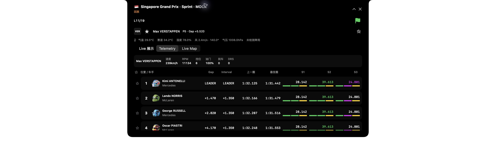

# Singapore 2026 Sprint Nook mock demo

This is synthetic visual demonstration data, not recorded timing or Singapore Sprint results. The existing `live_replay` example now accepts `singapore-sprint`; it remains loopback-only, disables F1/Jolpica/OpenF1 ingestion and uses a temporary SQLite database. Session/circuit metadata matches the existing 2026 calendar. The 22-driver roster uses current names/numbers; order, 19-lap progression, gaps, sectors, telemetry, weather, Race Control messages and geographic motion are invented. Source mode is `replay`; the expanded title includes `MOCK` and the compact view retains `回放`. No mock radio audio is provided.

Run with an unused loopback port and the public Mapbox token supplied externally:

```sh
F1_COMPANION_BIND=127.0.0.1:38974 cargo run --locked --manifest-path server/Cargo.toml --example live_replay -- singapore-sprint
```

Launch the existing main App with process-only `-serverAddress http://127.0.0.1:38974 -notchAutoShowEnabled YES -selectedSeason 2026 -remindersEnabled NO` overrides. No second Live window or App is created. On 2026-10-11 the ordinary server remained healthy on its original port, the saved server address stayed unchanged, and exactly one main App remained. The demo is left running for the user's inspection; quitting and opening the App normally restores the saved connection. Do not terminate the ordinary server when stopping this demo.

Actual native observations:

- Compact view: Singapore flag, Sprint, green flag, `回放`, lap count, favorite driver/position/gap.
- Expanded view: `Singapore Grand Prix · Sprint · MOCK`, 22 timing rows, dynamic selected-driver speed/RPM/gear/throttle/brake/DRS, synthetic weather and messages. The user changed the favorite to Max Verstappen; that choice was preserved.
- Telemetry / Live Map switched in the real Nook. Mapbox Standard loaded with pitch 55°, attribution, circuit outline data and moving synthetic car dots/labels. It does not establish real positioning or building coverage at every zoom.
- First native map attempt revealed `createImageBitmap` Blob decoding failure. A focused WebKit worker probe reproduced failure from `loadFileURL`; both blank-page and HTTPS-base HTML workers succeeded. The bundled map now loads using `loadHTMLString` with no base URL. Navigation stays restricted; CSP was not relaxed. The actual Nook then displayed the map and car markers without that error.
- The night style made custom dots/lines too dark and labels overlapped. Explicit emissive strength and collision-aware text were added. The final App build succeeded; final native confirmation of those paint changes remains unrecorded after the user resumed interaction. Mouse automation stopped for user inspection.

Actual native screenshots (the white surround is the capture's window masking):




Checks: Rust 95 unit/integration tests passed; the replay example's synthetic-source/freshness/moving-position/no-audio test passed separately. Rust fmt and all-target clippy passed. Xcode App build passed. The standalone Swift compatibility/freshness/RC/Radio cancellation/MapStore checks passed; four map-page tests passed, including night-overlay configuration and error-message URL/token redaction. Task-data validation and eight tests passed. No Xcode XCTest/UI suite, VoiceOver, additional display configuration, real Sprint feed, live vehicle calibration or audio playback acceptance was claimed.
